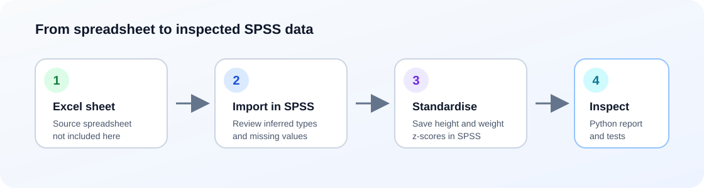
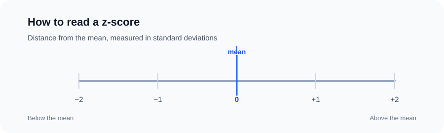

# SPSS Excel Import and Standardisation

An example SPSS dataset documenting the result of importing a small student
spreadsheet from Excel and standardising its height and weight measurements.
The repository includes the resulting SPSS `.sav` file, a Python inspection
utility, and tests that check the dataset's shape, missing values, and z-scores.

> **Scope:** this repository documents and inspects an existing SPSS file. It
> does not automate Excel-to-SPSS import or reproduce SPSS's analysis inside
> Python. The original Excel workbook and SPSS syntax/output file are not
> included.

## At a glance

- **Dataset:** 8 records and 12 variables in `data/imported_excel.sav`
- **Analysis example:** z-score standardisation of `height` and `weight`
- **Inspection:** print an SPSS data dictionary and a preview from the command line
- **Checks:** pytest verifies the data structure and standardisation results
- **Python:** 3.10 or newer

## Workflow

The illustration shows the analysis that produced the example file and the
inspection step this repository supports.



In SPSS, the example standardisation was run through
**Analyze → Descriptive Statistics → Descriptives**, with **Save standardized
values as variables** selected. The saved `.sav` file can then be checked with
the included Python script.

## Quick start

### 1. Set up the environment

```bash
git clone https://github.com/Stephen-Austine/spss-excel-import-standardization.git
cd spss-excel-import-standardization

python -m venv .venv
# macOS / Linux
source .venv/bin/activate
# Windows PowerShell: .venv\Scripts\Activate.ps1

python -m pip install -r requirements.txt
```

The project requires Python 3.10+. The dependencies include `pyreadstat` for
reading SPSS files, `pandas` and `numpy` for data handling, `tabulate` for
Markdown table output, and `pytest` for tests.

### 2. Inspect the example file

Print the variable dictionary and a preview of the first five records:

```bash
python inspect_sav.py data/imported_excel.sav
```

Print only a GitHub-friendly Markdown data dictionary:

```bash
python inspect_sav.py --markdown data/imported_excel.sav
```

The script accepts one or more `.sav` paths:

```bash
python inspect_sav.py data/imported_excel.sav path/to/another-file.sav
```

### 3. Run the tests

```bash
pytest
```

The same checks run in GitHub Actions on pushes to `main` and on pull requests,
using Python 3.10 and 3.12. To run the repository's configured linter locally,
install Ruff and run:

```bash
python -m pip install ruff
ruff check .
```

## Dataset guide

`data/imported_excel.sav` contains eight cases and twelve variables. SPSS
measurement levels and labels below are the metadata stored in the file.

| Variable | Label | Measure | Missing | Description |
| --- | --- | --- | ---: | --- |
| `ids` | — | Scale | 0 | Student identifier |
| `bday` | — | Scale | 0 | Birth date stored with SPSS `DATE10` format |
| `rank` | — | Nominal | 3 | Category codes 1–3 |
| `major` | — | Nominal | 0 | Text field; one entry is blank |
| `gender` | — | Nominal | 1 | Coded 0/1; no value labels are defined |
| `athlete` | — | Nominal | 0 | 0/1 indicator |
| `height` | — | Scale | 0 | Height measurement; units are not labelled |
| `weight` | — | Scale | 2 | Weight measurement; units are not labelled |
| `Zheight` | `Zscore(height)` | Scale | 0 | Standardised height |
| `Zweight` | `Zscore(weight)` | Scale | 2 | Standardised weight |
| `ZSco01` | `Zscore(height)` | Scale | 0 | Duplicate of `Zheight` |
| `ZSco02` | `Zscore(weight)` | Scale | 2 | Duplicate of `Zweight` |

The `major` field's blank text entry is not counted as a system-missing value in
the table. `rank`, `gender`, and `weight` have system-missing values as shown.

## Understanding the standardised values

A z-score expresses a value in standard-deviation units relative to the
variable's mean. A score of 0 is at the mean, a positive score is above it, and
a negative score is below it. The diagram is conceptual; it does not display
individual student records.



In this dataset, `Zheight` and `Zweight` have mean approximately 0 and sample
standard deviation approximately 1 across their valid cases. SPSS calculates
each score from the available observations for that variable. Consequently,
`Zweight` remains missing for the two records where `weight` is missing, and
six valid weight z-scores remain. The tallest recorded height (about 80 in the
dataset's unspecified units) has a `Zheight` of about 2.04.

## Data-quality notes

- **Repeated standardisation:** `ZSco01` duplicates `Zheight`, and `ZSco02`
  duplicates `Zweight`. These additional variables appear to have been created
  by running the standardisation more than once. Keep or remove them according
  to the purpose of your analysis.
- **Unlabelled codes:** `gender` and `athlete` use 0/1 codes but have no SPSS
  value labels. Confirm the intended meaning of each code from the source
  material before interpreting or recoding it.
- **Unspecified units:** the `height` and `weight` variables have no units in
  their metadata. Add verified units before sharing results.
- **Small sample:** eight records are provided as an instructional example;
  this dataset is not suitable for drawing general conclusions about students.

## Read the file in Python

The included script is useful for a quick report. For programmatic analysis,
`pyreadstat` can load the data and its SPSS metadata directly:

```python
import pyreadstat

data, metadata = pyreadstat.read_sav("data/imported_excel.sav")
print(data.head())
print(metadata.column_names_to_labels)
print(metadata.variable_measure)
```

To see all details gathered by the utility, including variable labels,
measurement levels, missing counts, and value labels:

```python
from pathlib import Path

from inspect_sav import dictionary

data, variable_dictionary = dictionary(Path("data/imported_excel.sav"))
print(variable_dictionary.to_string(index=False))
```

## Repository contents

| Path | Purpose |
| --- | --- |
| [`data/imported_excel.sav`](data/imported_excel.sav) | Example SPSS dataset |
| [`inspect_sav.py`](inspect_sav.py) | Command-line SPSS dictionary and preview utility |
| [`tests/test_data.py`](tests/test_data.py) | Dataset structure and z-score tests |
| [`docs/images/workflow.svg`](docs/images/workflow.svg) | Overview of the example workflow |
| [`docs/images/z-score-scale.svg`](docs/images/z-score-scale.svg) | Conceptual z-score illustration |
| [`.github/workflows/ci.yml`](.github/workflows/ci.yml) | GitHub Actions test and lint workflow |
| [`requirements.txt`](requirements.txt) | Python runtime and test dependencies |

## Privacy and responsible use

The included `.sav` file contains student identifiers and full birth dates.
Only publish or redistribute it when you have the appropriate permission and
have checked the applicable privacy requirements. For real student or
participant data, remove direct identifiers and assess whether dates or other
fields could still identify individuals. This small example should not be
treated as anonymised merely because the README does not display its records.

## License

Released under the [MIT License](LICENSE).
